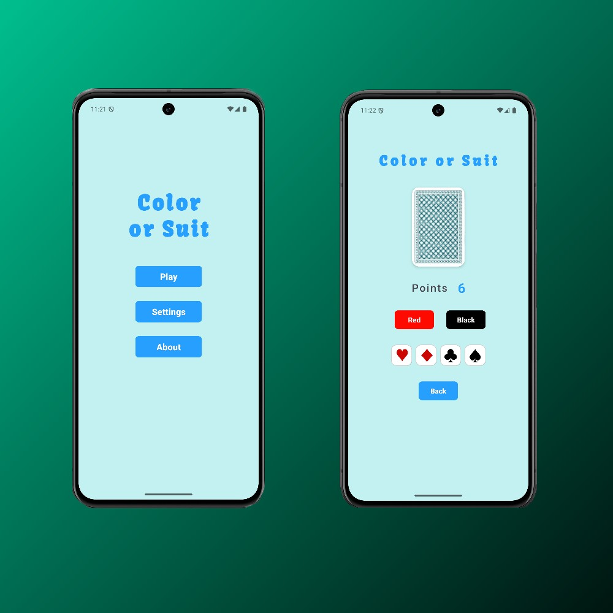

# Color or Suit Game

Color or Suit Game is an Android app where players guess the color or suit of a card to score points. The game is simple yet challenging and offers a fun experience for all ages.

## Features

- **Play**: Guess the color (red or black) or suit (hearts, diamonds, clubs, spades) of a card.
- **Scoring System**: Earn points based on your guesses. Get extra points (+5) for guessing the correct suit.
- **Animations**: Smooth two-phase 3D card-flipping animations using `ObjectAnimator`.
- **Sound Effects**: Responsive game audio with Android `SoundPool` — card flip, button clicks, correct/wrong guesses, special jackpot fanfare for suit hits, and win/lose sounds.
- **Dynamic Themes**: Instant switching between Light mode and Dark mode from Settings.
- **Difficulty Levels**:
  - **Easy**: Goal 15 points (winning range 15–18 p), loss only if score drops below -3 or over 18.
  - **Medium**: Classic Blackjack goal of exactly 21 points (loss if < 0 or > 21).
  - **Hard**: Goal 31 points (loss if < 0 or > 31).
- **Settings**: Customize the game (Sound on/off, Theme, Difficulty level) through the settings menu.
- **About / Rules**: Learn about rules and scoring system via the in-app dialog.
- **Multilingual Support**: Fully localized in English and Swedish based on system language.
- **Responsive Layouts**: Optimized layouts for small screens, large screens, tablets (`sw600dp`), and landscape mode.
- **State Preservation**: Uses Android `ViewModel` to preserve game score and state across screen rotations.

## What's New & Bug Fixes (v1.1)

- 🔊 **Sound System**: Added `SoundManager` using `SoundPool` integrated with `SharedPreferences` toggle. Includes button clicks, card flips, and custom victory audio (`wind.mp3`).
- 🎨 **Dynamic Theme Support**: Fully working Light & Dark theme toggle in Settings with automatic night-mode palette for activities and preference screens.
- 🎮 **Connected Difficulty Levels**: Settings now directly affect the game targets and win/loss thresholds (Easy: 15–18p, Medium: 21p, Hard: 31p).
- 🔄 **Screen Rotation Fix**: Integrated `GameViewModel` so score and card state survive orientation changes.
- 🚫 **Anti-Spam Button Protection**: Guess buttons are temporarily disabled during card flip animation to prevent multiple concurrent guesses.
- 🃏 **Suit Consistency**: Renamed internal suit identifier from `"Clover"` to `"Clubs"` to eliminate guess mismatch bugs.
- 🇸🇪 **Swedish App Name Fix**: Corrected Swedish launcher label from `"Test-3"` to `"Färg eller Svit"`.
- 📦 **Gradle Cleanup**: Removed duplicate legacy Material 1.4.0 dependency in Version Catalog, standardizing on Material 1.12.0.

## Installation

1. Clone this repository:
    ```bash
    git clone https://github.com/Jonasodiq/Color_or_suit.git
    ```
2. Open the project in Android Studio.
3. Build and run the app on an emulator or a physical device.

## Usage

- **Play**: Tap the "Play" button to start the game.
- **Guess**: Tap one of the color or suit buttons to make your guess.
- **Score**: See your current score at the top of the screen.
- **Settings**: Go to the settings menu to adjust sound, theme, and difficulty.
- **About**: Learn more about the game by tapping the "About" button.

## Design Sketch

- **View the design sketch on Figma**:
   https://www.figma.com/design/0SNhz9pbfg5JuEQESuAly7/Untitled?node-id=0-1&t=euFXdwTPnThEPwEb-1

## App Image


## Details

- **Developer**: Jonas N
- **Version**: 1.1.0
- **Platform**: Android Studio (Kotlin, MinSdk 29, TargetSdk 35)

## Contact

If you have any questions or suggestions, feel free to contact us at jonasniyazson@hotmail.com.
